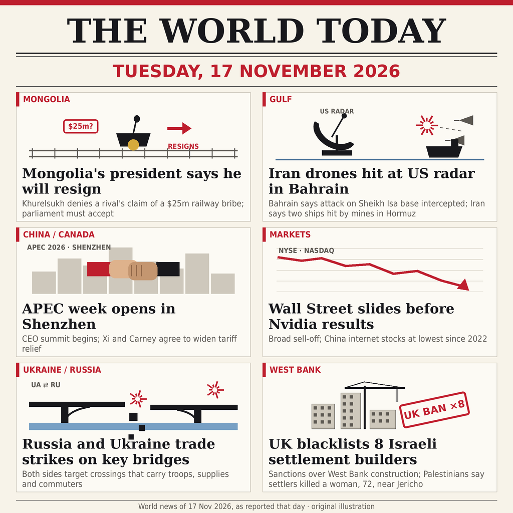

# The World Today: Tuesday, 17 November 2026

[](https://make.fun/c/news-image-20261117)
[](https://make.fun/c/news-image-20261117)
[](https://make.fun/c/news-image-20261117)

An entry for the make.fun competition [news-image-20261117](https://make.fun/c/news-image-20261117):
one image that sums up the world's news of Tuesday 17 November 2026.



## Stories

- **Mongolia:** President Khurelsukh says he will resign, denying a rival's claim of a $25m railway bribe.
- **Gulf:** Iran sends drones at a US radar at Bahrain's Sheikh Isa base; Bahrain says they were intercepted.
- **China / Canada:** APEC week opens in Shenzhen; Xi and Carney widen tariff relief.
- **Markets:** Wall Street slides ahead of Nvidia results; China internet stocks at lowest since 2022.
- **Ukraine / Russia:** both sides strike key bridges.
- **West Bank:** UK blacklists eight Israeli settlement construction firms.

## Run

`main.ts` (Node 22, standard library only) copies `entry.png` to `/output/entry.png`:

```sh
mkdir -p out && MAKEFUN_OUTPUT_DIR=out node main.ts
```

The picture is drawn from scratch by `tools/render.py` (Pillow, shapes and DejaVu fonts only):

```sh
python3 tools/render.py entry.png
```

Licensed MIT.
